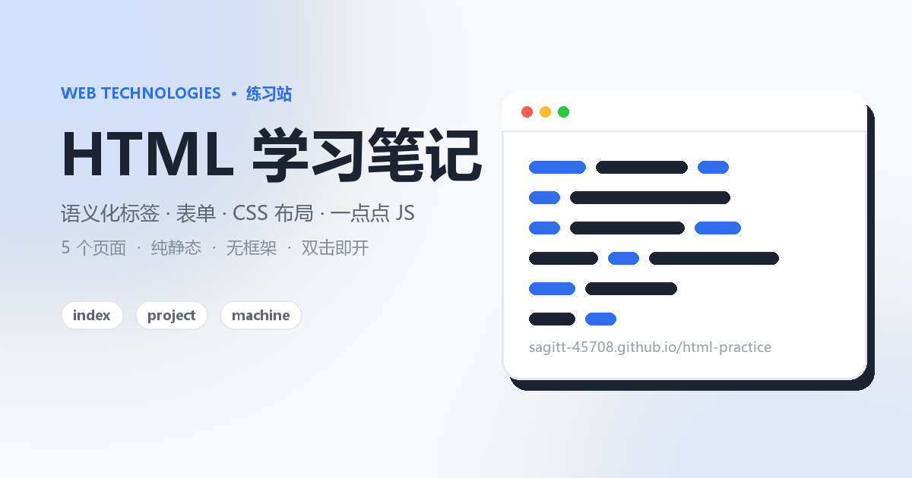

# HTML 学习笔记（练习站）

一个练手用的多页静态网站，纯 HTML + CSS + 原生 JavaScript，没有框架、没有构建步骤，双击 `index.html` 就能打开。

## 页面

| 文件 | 内容 | 练的知识点 |
| --- | --- | --- |
| `index.html` | 首页：介绍、四张卡片、学习清单 | 语义化标签、Grid 布局 |
| `project.html` | 三个练习项目 + 踩过的坑 | 列表、`code`、内部链接 |
| `quotes.html` | 四句名言 | `blockquote`、`cite` |
| `machine.html` + `machine.js` | 加减乘除小工具 | 表单、`select`、JS 计算与错误处理 |
| `contact.html` | 留言表单（不会真的发送） | `label`、`required`、`preventDefault` |

## 其他文件

- `styles.css`：全站统一样式，蓝灰配色、卡片布局，600px 以下单列
- `nav.js`：根据当前文件名点亮导航，并填写页脚年份

## 怎么打开

直接双击 `index.html`，或者在 VSCode 里用 Live Server 打开。页面之间用相对路径链接，不依赖服务器。

## 注意

- `contact.html` 的表单只做前端演示，**不会真的发送**数据
- `machine.html` 里除以 0、输入非数字都会给出提示，不会出现 `Infinity`
